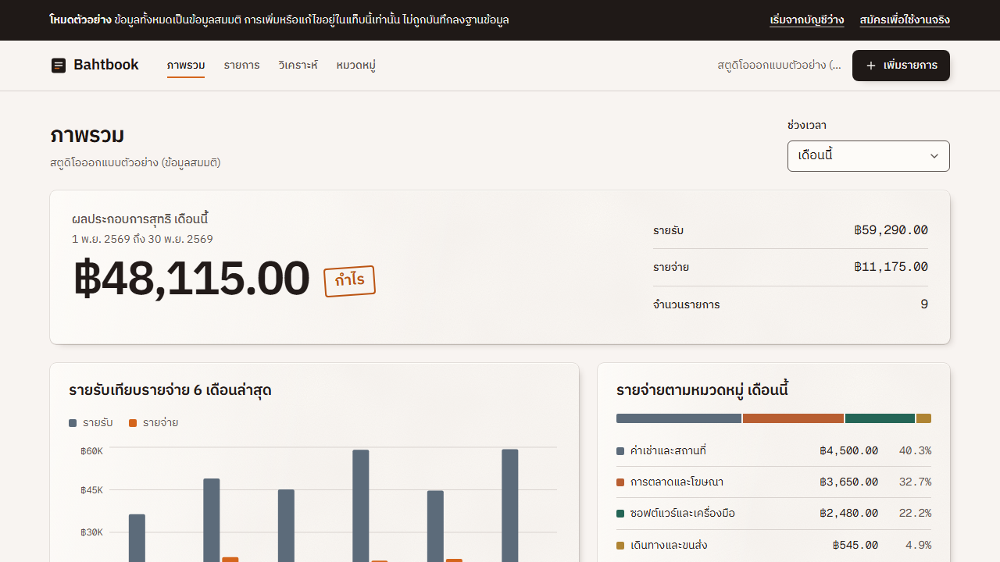

# Business Expense Tracker

A full-stack web application for freelancers and small business owners to record
business income and expenses and see where the money goes. The interface is in
Thai, amounts are in Thai baht, and dates follow the Asia/Bangkok business day.

This is a **portfolio demonstration**. The product name used in the interface,
"Bahtbook", is fictional, and all sample data is fictional. It is not a
commercial service.



## Contents

- [Features](#features)
- [Tech stack](#tech-stack)
- [Architecture](#architecture)
- [Database](#database)
- [Authentication and Row Level Security](#authentication-and-row-level-security)
- [Setup](#setup)
- [Commands](#commands)
- [Testing](#testing)
- [Public demo and its limits](#public-demo-and-its-limits)
- [Deployment](#deployment)
- [Security](#security)
- [Licences](#licences)

## Features

| Area         | What it does                                                                                                                                                                                         |
| ------------ | ---------------------------------------------------------------------------------------------------------------------------------------------------------------------------------------------------- |
| Accounts     | Sign up, log in, log out, persistent session, protected routes (Supabase Auth)                                                                                                                       |
| Dashboard    | Net result, total income, total expenses and transaction count for a chosen period; income vs. expenses for the last six months; expense breakdown by category; recent transactions; monthly summary |
| Transactions | Add, edit and delete, with category, date, description and type; validation on the client and again on the server; delete confirmation; protection against double submission                         |
| History      | Search, filter by type, category and date range, sort by date or amount; table on desktop, stacked rows on a phone; the view is kept in the URL                                                      |
| Analytics    | Monthly income vs. expenses, net result trend, expense share by category, and facts computed from the records; every chart has a data table                                                          |
| Categories   | Default categories for new accounts; create, rename, recolour and delete; a category in use cannot be deleted                                                                                        |
| CSV export   | Exports the filtered rows as UTF-8 with BOM (Thai opens correctly in Excel) with formula-injection escaping                                                                                          |
| Demo         | A public, clearly labelled sample workspace that never touches the database                                                                                                                          |

Every figure is computed from stored transactions. Nothing on the dashboard or
the analytics page is a fixed or invented number.

## Tech stack

| Layer          | Choice                                                                                                 |
| -------------- | ------------------------------------------------------------------------------------------------------ |
| Framework      | Next.js 16.4 (App Router, Server Components, Server Actions), React 19, TypeScript 6                   |
| Database       | Supabase PostgreSQL with Row Level Security                                                            |
| Authentication | Supabase Auth through `@supabase/ssr` (cookie session, server side)                                    |
| Styling        | Tailwind CSS 4 with a small token file (`src/app/tokens.css`)                                          |
| Charts         | Recharts 3                                                                                             |
| Validation     | Zod 4, one schema shared by the browser and the server                                                 |
| Tests          | Vitest 5 (unit), PGlite (PostgreSQL in WebAssembly, for schema and RLS tests), Playwright (end to end) |

## Architecture

```
Browser ──HTTPS──▶ Next.js server ──HTTPS + user's JWT──▶ Supabase (Auth, PostgREST) ──▶ PostgreSQL + RLS
  (no Supabase keys,      (Server Components read,                                     (every row checked
   httpOnly session        Server Actions write,                                        against auth.uid())
   cookie only)            Zod validates input)
```

- **The browser never talks to Supabase.** All reads happen in Server Components
  and all writes in Server Actions, using the signed-in user's own session. No
  Supabase key is included in the client bundle, and no `NEXT_PUBLIC_*` variable
  is used.
- **No service-role key anywhere.** The server uses the publishable (anon) key
  plus the user's session, so Row Level Security applies to every query. If a
  secret or service-role key is supplied by mistake, the server rejects it
  instead of using it (`src/lib/supabase/env.ts`).
- **One set of screens, two data sources.** The screens in
  `src/components/workspace` depend only on a `WorkspaceActions` interface. The
  signed-in app (`/app`) passes Server Actions that write to PostgreSQL; the
  demo (`/demo`) passes an in-memory store. The demo therefore shows the real
  interface, not a copy of it.
- **Calculations are plain functions** in `src/lib/finance` (money, dates,
  aggregation, filtering, CSV, validation) with no framework dependencies. They
  are the most heavily tested part of the project.

```
src/
  app/
    page.tsx                 landing page
    (auth)/                  login, sign-up and their Server Actions
    auth/confirm/route.ts    email confirmation link
    app/                     signed-in workspace: layout loads data, actions.ts writes
    demo/                    public sample workspace
  components/
    workspace/               shell, the four screens, dialogs
    charts/                  Recharts wrappers with data tables
    demo/                    demo provider and banner
  lib/
    finance/                 pure domain logic
    supabase/                server client, queries, env checks, table types
    demo/                    sample data and in-memory store
  proxy.ts                   session refresh and the /app redirect
supabase/migrations/         SQL schema, constraints, triggers and RLS policies
tests/unit/                  Vitest
tests/integration/           migrations and RLS against PGlite
e2e/                         Playwright
scripts/screenshots.mjs      regenerates the images in screenshots/
```

### Money and dates

- Amounts are stored and calculated as **integer satang** (`bigint`, 1 baht =
  100 satang). Baht values are never held in floating point, so `0.10 + 0.20`
  is exactly `0.30`. Input such as `1,250.50` is parsed with string handling,
  not `parseFloat`.
- A transaction date is a plain `date`. "Today" and period boundaries are
  computed in **Asia/Bangkok** regardless of the server or browser timezone.
- Display uses `Intl` with the `th-TH` locale: `฿1,250.50` and dates in the
  Buddhist era (`15 พ.ย. 2569`).

## Database

Schema: [`supabase/migrations/20261115000000_init.sql`](supabase/migrations/20261115000000_init.sql)

| Table          | Columns                                                                                                                | Notes                                                                                                                                          |
| -------------- | ---------------------------------------------------------------------------------------------------------------------- | ---------------------------------------------------------------------------------------------------------------------------------------------- |
| `profiles`     | `id` (PK, FK to `auth.users`), `display_name`, `created_at`                                                            | One row per account, created by a trigger                                                                                                      |
| `categories`   | `id`, `user_id`, `name`, `type`, `color`, `created_at`                                                                 | `type` is `income` or `expense`; `color` is a key from a fixed palette; name is unique per user and type, ignoring case and surrounding spaces |
| `transactions` | `id`, `user_id`, `category_id`, `type`, `amount_satang`, `description`, `transaction_date`, `created_at`, `updated_at` | `amount_satang` is a positive `bigint` up to 999,999,999,999                                                                                   |

Integrity rules enforced by the database, not only by application code:

- **Composite foreign key** `transactions (category_id, user_id, type)` →
  `categories (id, user_id, type)`. A transaction can only use a category that
  belongs to the same user and has the same type.
- A category that transactions still reference **cannot be deleted**. The key
  uses `NO ACTION`, which is checked at the end of the statement, so deleting a
  whole account still cascades cleanly.
- `CHECK` constraints on amount range, text lengths, the date range (2000 to
  2100), the type and the colour key.
- `user_id` defaults to `auth.uid()`. The application never sends a user id.
- `updated_at` is maintained by a trigger.
- A trigger on `auth.users` creates the profile and eleven default categories
  for each new account.
- Indexes: `(user_id, transaction_date desc, created_at desc)` and
  `(category_id)`.

The migration is repeatable: it can be run again without errors or duplicates.

## Authentication and Row Level Security

**Authentication**

- Email and password through Supabase Auth. Passwords are handled only by
  Supabase; this project stores none.
- The session lives in a cookie written by the server with `httpOnly`,
  `sameSite=lax` and, in production, `secure`. Page scripts cannot read the
  tokens.
- `src/proxy.ts` refreshes the session on each request and redirects signed-out
  visitors away from `/app`. That is a convenience. The workspace layout and
  every Server Action verify the user with the Auth server again, and the
  database enforces access on its own.
- Sign-up always answers "check your email" when confirmation is on, so the
  form cannot be used to discover which addresses are registered.
- The post-login `next` address is restricted to paths inside `/app`.

**Row Level Security**

RLS is enabled on all three tables, with ten policies in total.

| Table          | `authenticated` may                                                  | `anon` may |
| -------------- | -------------------------------------------------------------------- | ---------- |
| `profiles`     | select and update its own row (`auth.uid() = id`)                    | nothing    |
| `categories`   | select, insert, update, delete its own rows (`auth.uid() = user_id`) | nothing    |
| `transactions` | select, insert, update, delete its own rows (`auth.uid() = user_id`) | nothing    |

Table privileges are granted explicitly to `authenticated` and revoked from
`anon`, so the schema does not depend on a project's default grants. Update
policies use both `USING` and `WITH CHECK`, so a row cannot be handed to another
user.

## Setup

Requirements: Node.js 22.12 or newer, and a Supabase project (the free tier is
enough). Use a separate project for testing if you plan to run the signed-in
end-to-end tests.

1. **Install**

   ```bash
   npm install
   ```

2. **Create the database objects.** In the Supabase dashboard open
   _SQL Editor_, paste the contents of
   `supabase/migrations/20261115000000_init.sql` and run it. With the Supabase
   CLI the equivalent is `supabase link --project-ref <ref>` followed by
   `supabase db push`.

3. **Configure environment variables.** Copy `.env.example` to `.env.local`
   and fill it in from the project's **Connect** dialog or from
   _Settings → API Keys_:

   ```bash
   SUPABASE_URL=                # https://<project-ref>.supabase.co
   SUPABASE_PUBLISHABLE_KEY=    # sb_publishable_... or the legacy anon key
   SITE_URL=http://localhost:3000
   ```

   Never put the secret or service-role key here. Nothing in this project
   needs it.

4. **Configure Supabase Auth** (_Authentication_ in the dashboard):

   | Setting                                        | Value                                                                                           |
   | ---------------------------------------------- | ----------------------------------------------------------------------------------------------- |
   | URL Configuration → Site URL                   | `http://localhost:3000` (your domain in production)                                             |
   | URL Configuration → Redirect URLs              | `http://localhost:3000/auth/confirm` and `https://<your-domain>/auth/confirm`                   |
   | Email provider → Confirm email                 | On for a public site. Off is convenient for local development: sign-up then logs in immediately |
   | Email provider → Minimum password length       | 8, to match the form                                                                            |
   | Email Templates → Confirm signup (recommended) | Set the link to `{{ .SiteURL }}/auth/confirm?token_hash={{ .TokenHash }}&type=email`            |

   The default email template also works (the route handles both link styles),
   but then the link must be opened in the same browser that signed up. With
   confirmation on, Supabase's built-in email sender is limited to a few
   messages per hour; a public site needs custom SMTP.

5. **Run**

   ```bash
   npm run dev
   ```

   Open <http://localhost:3000>. Without `.env.local` the demo at `/demo` still
   works, and the login and sign-up pages explain that Supabase is not connected.

## Commands

| Command                           | Purpose                                                                      |
| --------------------------------- | ---------------------------------------------------------------------------- |
| `npm run dev`                     | Development server                                                           |
| `npm run build` / `npm run start` | Production build and server                                                  |
| `npm run check`                   | Prettier check, ESLint, TypeScript, unit and integration tests               |
| `npm run test`                    | Unit and integration tests (Vitest)                                          |
| `npm run test:e2e`                | End-to-end tests (Playwright). Builds and starts its own server on port 3100 |
| `npm run screenshots`             | Regenerates `screenshots/` from a running server (see the script header)     |
| `npm run format`                  | Formats the project with Prettier                                            |

## Testing

| Layer                                                              | What it proves                                                                                                                                                                                                                      | Needs Supabase |
| ------------------------------------------------------------------ | ----------------------------------------------------------------------------------------------------------------------------------------------------------------------------------------------------------------------------------- | -------------- |
| Unit, `tests/unit`                                                 | Money parsing and formatting, Bangkok dates and periods, totals, monthly and category aggregation, filtering, sorting, URL state, validation, CSV escaping, the redirect guard, the demo store                                      | No             |
| Integration, `tests/integration`                                   | The real migration file run on PGlite (PostgreSQL compiled to WebAssembly): constraints, the composite foreign key, triggers, and Row Level Security for owner, other user and signed-out visitor, plus the manual RLS check script | No             |
| End to end, `e2e/demo-workspace.spec.ts`, `e2e/auth-guard.spec.ts` | The three user journeys, validation, double submission, filters, sorting, CSV download, categories, charts, navigation and overflow at 1440px, 768px and 375px, route protection, auth form validation, security headers            | No             |
| End to end, `e2e/auth-live.spec.ts`                                | Real login, a transaction created, edited and deleted in PostgreSQL and re-read after reload, logout                                                                                                                                | **Yes**        |

**Results on 15 November 2026** (Windows 11, Node 24):

| Check                    | Result                         |
| ------------------------ | ------------------------------ |
| `npx prettier --check .` | Pass                           |
| `npx eslint .`           | Pass                           |
| `npx tsc --noEmit`       | Pass                           |
| `npx vitest run`         | 133 passed                     |
| `npx playwright test`    | 79 passed, 5 skipped, 0 failed |

**Not yet verified.** The 5 skipped tests are the 4 signed-in tests in
`auth-live.spec.ts` (2 tests on 2 screen sizes) plus one keyboard test that is
deliberately run on desktop only. The signed-in tests were skipped because no
Supabase project was available when this was built. Until they are run against
a real project, the following has **not** been exercised end to end: sign-up
and login against Supabase Auth, the confirmation email link, and the Server
Actions reading and writing through PostgREST. The SQL itself (schema,
constraints, RLS) is covered by the integration tests, with one caveat: PGlite
uses a small shim for `auth.users`, `auth.uid()` and the `anon` /
`authenticated` roles, which Supabase normally provides.

**Running the signed-in tests safely.** They create and delete rows, so they
run only when all of the following are set in `.env.local`:

```bash
SUPABASE_URL=...               # a dedicated TEST project, never production
SUPABASE_PUBLISHABLE_KEY=...
E2E_USER_EMAIL=...             # a throwaway, already confirmed user in that project
E2E_USER_PASSWORD=...
E2E_CONFIRM_TEST_PROJECT=yes   # your statement that this project is not production
```

Create that user under _Authentication → Users → Add user_ with "Auto Confirm
User" ticked, and do it **after** applying the migration: the profile and the
default categories are created by a trigger at the moment the user is created.

Then run `npm run test:e2e`. With the settings in place the expected result is
83 passed and 1 skipped. The tests only touch rows they created under that one
account. Playwright never attaches to a server that is already running: if port
3100 is taken, the run stops instead of testing an unknown application.

**Verifying isolation between two users.** Create a second user the same way,
then:

1. _In the database._ Open
   [`supabase/tests/rls_isolation_check.sql`](supabase/tests/rls_isolation_check.sql)
   in the Supabase SQL Editor, put the two test email addresses at the top and
   run it. Acting as the first user it creates one transaction; acting as the
   second user and as a signed-out visitor it then tries to read, update,
   delete and forge data. It ends with `PASS: 10 of 10 RLS isolation checks`,
   or stops with an error naming the check that failed. It removes its own row
   and rolls back on failure. The integration tests run this same file against
   PGlite, including a run with RLS switched off to prove that it fails.
2. _In the application._ Log in as the first user in one browser and as the
   second in a private window. Add a transaction as the first user; it must not
   appear for the second, and each dashboard must show only its own totals.

## Public demo and its limits

`/demo` is safe to publish:

- It makes **no database calls**. Sample data is generated on the server from a
  fixed template, dated relative to today, and handed to the page.
- Changes a visitor makes live in that browser tab's memory. They are not sent
  anywhere, are not shared with other visitors, and disappear on reload.
- It never claims a write happened: the banner says so, and every confirmation
  message ends with "ไม่ได้บันทึกลงฐานข้อมูล" (not saved to the database).
- There is no shared demo account, no published credentials and no anonymous
  access to any table.
- "เริ่มจากบัญชีว่าง" clears the samples to show what a new account looks like.

What needs a real account: anything that should persist. Sign-up is open, and
each account sees only its own data.

Known limits of this demonstration:

- The workspace loads all of a user's transactions (in pages of 1,000, up to
  20,000) and aggregates them in the application. That suits the freelancer
  volumes this is designed for; a larger deployment should move aggregation
  into SQL views and paginate the history on the server.
- There is no password reset, profile editing, multi-currency, receipt upload
  or recurring transactions.
- The interface is Thai only.
- `robots` is set to `noindex`.

## Deployment

Nothing has been deployed. To deploy (for example on Vercel):

1. Create the production Supabase project and run the migration.
2. Set `SUPABASE_URL`, `SUPABASE_PUBLISHABLE_KEY` and `SITE_URL` (the public
   `https://` address) in the host's environment settings. Do not add any
   secret key.
3. In Supabase Auth set the Site URL and add
   `https://<your-domain>/auth/confirm` to the Redirect URLs.
4. Turn "Confirm email" on and configure custom SMTP before sharing the link
   publicly.
5. Build with `npm run build`. The app needs a Node.js runtime (it is not a
   static export).
6. After deploying, sign up with a test address, add and delete one
   transaction, and confirm that a second account cannot see it.

## Security

- **Access control is in the database.** Even a bug in the application code
  cannot return another user's rows, because RLS filters every query.
- **No privileged credentials** in the application or the repository. `.env*`
  files are git-ignored except `.env.example`, which holds no values.
- **Input is validated at the boundary**: Zod schemas run in the browser for
  feedback and again in every Server Action. Database constraints are the last
  line of defence.
- **Errors**: users see short Thai messages; only an operation name and a
  Postgres error code are logged. Credentials, tokens and row contents are
  never logged.
- **Headers**: a Content Security Policy that limits connections to the site's
  own origin, `X-Frame-Options: DENY`, `X-Content-Type-Options: nosniff`,
  `Referrer-Policy` and `Permissions-Policy`. The policy allows inline scripts
  and styles, which Next.js needs without a nonce setup; a nonce-based policy
  would be stricter.
- **CSV export** escapes quotes and neutralises cells beginning with `=`, `+`,
  `-`, `@`, tab or carriage return.
- **Dependencies**: `npm audit --omit=dev` reports 0 vulnerabilities. `npm
audit` reports 7 moderate findings, all one advisory in `minimatch` inside
  the ESLint toolchain, which runs only during development. It has no
  non-breaking fix at the time of writing.

## Licences

| Asset                                                                   | Licence                   |
| ----------------------------------------------------------------------- | ------------------------- |
| IBM Plex Sans Thai, Geist Mono (self-hosted by `next/font`)             | SIL Open Font License 1.1 |
| Lucide icons                                                            | ISC                       |
| Next.js, React, Tailwind CSS, Recharts, Zod, Supabase libraries, Vitest | MIT                       |
| TypeScript, Playwright, PGlite                                          | Apache-2.0                |

The paper texture is an SVG filter written for this project. No photographs or
third-party images are used. The application code is unlicensed portfolio work.
